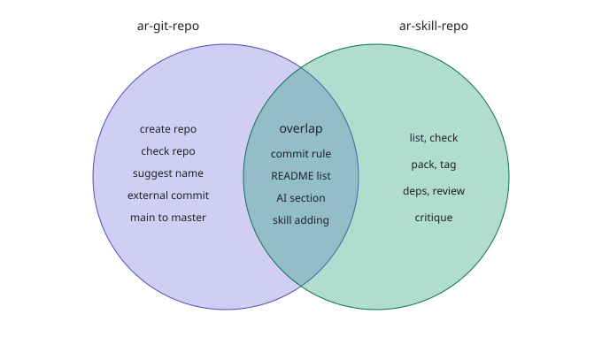

# ar-skills

A collection of Claude skills by Antti Raisala.

<!-- ai:start -->
## For use with AI

Repository: https://github.com/anttiraisala/ar-skills (default branch: `master`)

Clone everything:

```
git clone https://github.com/anttiraisala/ar-skills.git
```

Download the whole collection as a ZIP: https://github.com/anttiraisala/ar-skills/archive/refs/heads/master.zip

Download one skill (example: `ar-git-repo`):

```
curl -L -o SKILL.md https://raw.githubusercontent.com/anttiraisala/ar-skills/master/skills/ar-git-repo/SKILL.md
```

Start prompt for an AI agent (copy and paste):

```
Read the skills in this repository and take them into use.

1. Clone https://github.com/anttiraisala/ar-skills.git (branch master), or read the files directly from GitHub.
2. Read CLAUDE.md first, then every skills/<name>/SKILL.md. Each file starts with a name and a description that says when the skill applies.
3. If you can install skills (for example in Claude Code: copy each folder skills/<name>/ to ~/.claude/skills/), do that. Otherwise follow the skills for the rest of this session whenever their description matches my request.
4. A skill with a "Requires:" line needs the named skills too.
5. Do not change the repository or commit anything unless I ask. Tell me in a few lines which skills you loaded.
```

Rules for AI assistants working in this repo are in [CLAUDE.md](CLAUDE.md); status is in [PROGRESS.md](PROGRESS.md). Each skill is a folder `skills/<name>/` with a `SKILL.md`.
<!-- ai:end -->

## Skills

<!-- skills:start -->
| Skill | Version | What it does | Download |
|---|---|---|---|
| [ar-git-repo](skills/ar-git-repo/) | 5 | Creates, checks and maintains GitHub repositories (master branch, MIT, README, CLAUDE.md, PROGRESS.md), suggests repo names, builds a tested external commit zip (with an executable apply script) when a push fails, and keeps this list up to date. | [SKILL.md](https://raw.githubusercontent.com/anttiraisala/ar-skills/master/skills/ar-git-repo/SKILL.md) |
| [ar-requirement-driven-development](skills/ar-requirement-driven-development/) | 1 | Guides Requirement Driven Development (RDD) in a project: interviews the user and keeps the requirements, ideas, action points and progress files current. | [SKILL.md](https://raw.githubusercontent.com/anttiraisala/ar-skills/master/skills/ar-requirement-driven-development/SKILL.md) |
| [ar-skill-repo](skills/ar-skill-repo/) | 5 | Maintains this skills collection: add, update, check, pack and tag skills, keeps the README AI section and skill list in sync, checks Requires links, writes the skill critique report. | [SKILL.md](https://raw.githubusercontent.com/anttiraisala/ar-skills/master/skills/ar-skill-repo/SKILL.md) |
<!-- skills:end -->

## Commands

<!-- commands:start -->
### ar-git-repo v5

Creates, checks and maintains Git repositories with the maintainer's defaults: owner `anttiraisala`, public, branch `master`, MIT licence. Every commit follows one rule: update the description files, announce the commit, wait for the go-ahead, then check that the remote equals `HEAD`. Everything written into a repository is English.

| Command | Triggers | What it does |
|---|---|---|
| Mode 1: create a repo | `create a repo` | Asks for name and purpose, creates the repo with `gh`, makes `master` the default branch and writes LICENSE, README, .gitignore, CLAUDE.md and PROGRESS.md. |
| Mode 2: check repo | `check repo`, `tsekkaa repo`, `fix main/master` | Read-only check of owner, access, branches, pull requests and base files; compares the saved skill version with the repo; proposes numbered fixes, including renaming `main` to `master`. |
| Mode 3: skills collection | `add a skill to ar-skills` | Rules for adding or changing a skill in ar-skills and keeping the README list in step. |
| Mode 4: suggest repo name | `suggest repo name`, `ehdota repon nimeä`, `keksi repolle nimi` | Proposes 20 names in five styles, drops names the owner already uses and shows three favourites; creates nothing. |
| Mode 5: external commit | `external commit`, `ulkoinen commit`, `tee ulkoinen commit`, `deferred commit` | When a commit or push fails (or on request), runs `tools/build-external-commit.sh` to build `external-commit-<repo>-<YYYYMMDDHHMMSS>.zip`: the files, an executable `apply-external-commit.sh` (checks, `--dry-run`, `--no-push`, PASS line and undo command), `REPORT.md`, `PROMPT.txt` and `SHA256SUMS`. `tools/selftest-external-commit.sh` tests it end to end. |

### ar-requirement-driven-development v1

Guides Requirement Driven Development (RDD) in a project with `RDD-REQUIREMENTS.md`, `RDD-IDEAS.md` and `RDD-PROGRESS.md`. The user decides: AI suggestions become ideas first, requirements change only after acceptance, and nothing is implemented without an explicit go. A requirement is verified only with evidence.

| Command | Triggers | What it does |
|---|---|---|
| help | `rdd help`, `rdd ohje`, `mitä osaat` | Lists what the skill can do, shows counts per status, drift and a recommended next step. |
| status | `rdd status` | Read-only state and drift report. |
| init | `rdd init` | Creates the three RDD files and adds the rules block to `CLAUDE.md`; offers it first, never converts a project silently. |
| overview | `yleiskuva` | Creates or edits the Overview (purpose, users, scope, constraints) with the user. |
| idea | `lisää idea`, `hio ideaa <id>`, `hylkää idea <id>` | Adds, refines or drops an idea in `RDD-IDEAS.md`. |
| requirement | `lisää vaatimus`, `ylennä idea <id>` | Proposes a requirement or promotes an idea; it is written only after the user accepts it. |
| actions | `tiivistä toimenpiteiksi <REQ>` | Splits a requirement into small, checkable action points. |
| do | `toteuta <AP tai REQ>` | Implements named action points or a requirement, only on an explicit go. |
| verify | `varmenna <REQ>` | Checks the result against the acceptance criterion and records evidence. |
| check | `rdd check` | Read-only lint of IDs, links between ideas, requirements and progress rows, and statuses. |

### ar-skill-repo v5

Maintains this repository: one folder per skill, the README AI section, skill list, command overview and critique block, plus `PROGRESS.md` and `CLAUDE.md`. Every commit is announced and waits for the go-ahead. A session cannot update the account copy of a skill; the user saves it from a review card.

| Command | Triggers | What it does |
|---|---|---|
| list | `listaa skillit` | Read-only list of skills with version, description and size; marks mismatches with the README. |
| add | `lisää skilli`, `lisää skilli repoon` | Validates and adds a skill, runs `sync`, writes its command section, then follows the commit rule. |
| update | `päivitä skilli <n>` | Edits a skill, raises its version and refreshes README and PROGRESS.md. |
| rename and remove | on explicit request | Renames or deletes a skill folder and keeps the README in step; the user deletes the account copy himself. |
| sync | `synkkaa lista`, `päivitä README` | Rewrites the AI section (clone commands and agent start prompt) and the skill list with the script; adds empty command overview markers if missing. |
| check | `tsekkaa skillit` | Read-only lint of the whole collection (eleven rules: versions, links, dependencies, critique, command overview). |
| deps | `riippuvuudet` | Shows `Requires:` links and reports missing skills and cycles. |
| status | `skill repo status` | Read-only git status and log, remote equals `HEAD`, README drift. |
| pack | `paketoi skilli <n>` | Builds a zip of one skill for upload in Claude settings; the zip is not committed. |
| tag | `tagaa versio` | Creates and pushes an annotated tag `<n>-vN` on request. |
| history | `skillin historia <n>` | Shows the git log of a skill with its PROGRESS.md rows and versions. |
| new | `uusi skilli` | Scaffolds a skill from the template and finishes through `add`. |
| review | `arvioi skilli <n>` | Read-only quality review of one skill with concrete wording fixes. |
| critique | `skill critique`, `skill-raportti`, `arvioi kokoelma` | Critical report on the whole collection with at most seven findings and a Venn diagram; updates the README critique block. |
<!-- commands:end -->

## Skill critique

<!-- critique:start -->
AI-generated critique, 2026-11-06. Covers: ar-git-repo v4, ar-requirement-driven-development v1, ar-skill-repo v4.



| # | Finding | Evidence | Proposal | Status |
|---|---------|----------|----------|--------|
| 1 | The commit rule is written in two skills. | ar-git-repo "Rule for every commit"; ar-skill-repo "Rule for every commit" | Keep the full rule in ar-git-repo; in ar-skill-repo keep three lines and refer to it (`Requires:` is only a pointer). | open |
| 2 | The skills collection is handled by two skills. | ar-git-repo "Mode 3" and "Source and updating"; ar-skill-repo `add`, `update`, `sync` | Cut ar-git-repo Mode 3 to one line that points to ar-skill-repo. | open |
| 3 | Both descriptions fire on "add a skill to ar-skills". | ar-git-repo description; ar-skill-repo description | Remove that phrase from the ar-git-repo description. | open |
| 4 | The two skills that maintain repos are the largest: ar-skill-repo 17.6 kB (14 commands, two embedded Python scripts), ar-git-repo 14.7 kB (five modes). | `wc -c` of both SKILL.md files | Move the scripts of ar-skill-repo into files the skill refers to; make ar-git-repo Mode 5 its own skill (`ar-external-commit`). | open |
| 5 | Parts nobody has run: the external commit package (Mode 5), the `sync` and `deps` scripts, and the RDD skill in a real project. | PROGRESS.md "Testing" and rows 3, 5, 6, 7 | Dry run each on a throwaway repo or project and record the result in PROGRESS.md. | open |
| 6 | An instruction is out of date: when a push is impossible, ar-skill-repo says to give the files to the user. | ar-skill-repo "Setup at the start of every session", step 1 | Refer to ar-git-repo Mode 5 (external commit) in the next ar-skill-repo version. | open |
| 7 | Gap: nothing compares the saved (account) copies of all skills with the repo; only ar-git-repo checks itself, and ar-git-repo was one version behind earlier today. | ar-git-repo Mode 2 step 0; ar-skill-repo `check` rule 9 (needs a pasted copy) | Let `check` load each saved skill, read its `Version:` and compare with the repo. | open |
<!-- critique:end -->

## Licence

MIT, see [LICENSE](LICENSE).
